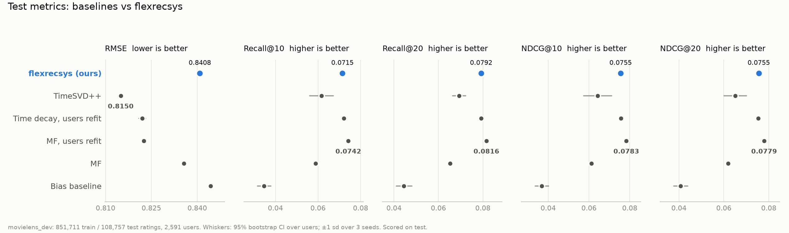
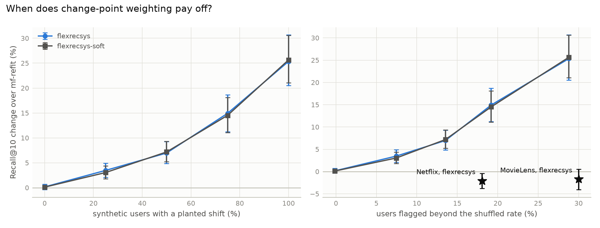

# flexrecsys

Detecting preference shifts in matrix factorization recommenders.

Most time-aware recommenders assume user tastes drift smoothly and down-weight old ratings with a continuous decay. With flexrecsys, we instead treat preference changes as discrete events. The system locates a change point in each user's rating history with a Bayesian test and re-estimates the user from the ratings that follow it.

The system has three stages:

1. **Train matrix factorization** with weight decay.
2. **Detect change points**: for each user, the probability that their taste changed, and where.
3. **Re-solve each user exactly** with the movie vectors frozen, using the change points to decide how much each rating counts.

Without stage 2, every rating counts fully and the system is the two-stage model `mf-refit`. With it, the adaptive variant `flexrecsys-soft` chooses on validation how far a flagged user may move away from their full-history profile, so it can fall back to `mf-refit` when change points don't help.

## Summary of results

1. **The two-stage model out-ranks TimeSVD++ on two datasets.** Stages 1 and 3 alone (`mf-refit`) beat TimeSVD++ on held-out test Recall@10 by 20% on MovieLens (0.0742 against 0.0616, paired difference +0.0126, 95% interval +0.0084 to +0.0166) and by 26% on Netflix (0.0622 against 0.0495, paired difference +0.0128, interval +0.0087 to +0.0168). It trains in about 6 seconds against 140. TimeSVD++ keeps the better RMSE on both.
2. **The original gap to TimeSVD++ was a regularization artifact.** Switching off every time-aware component of TimeSVD++ leaves its ranking unchanged. Training plain MF with the same regularization closes the gap.
3. **Change-point weighting works when shifts are lasting, and does not help on MovieLens or Netflix.** Three detectors were tried: the proposal's online BOCPD on embedding windows (`flexrecsys-v1`), BOCPD on prediction errors (`bocpd.py`), and an offline rating-space test (`flexrecsys`). On synthetic data with planted shifts the rating-space detector improves Recall@10 by 7% over `mf-refit`. On real data none of them gives a confirmed improvement over using the full history. The only candidate is a 0.15% validation RMSE gain for one setting of BOCPD on prediction errors, chosen from a sweep and not yet checked on held-out data or on ranking. The detector does respond to real structure: it flags 35% of MovieLens users against 5% on shuffled histories, and flagged users' genre mix moves more than unflagged users'. A sweep over the share of synthetic users with a planted shift shows the gain growing steadily with that share, to 25% when every user shifts. At the same flag rates as Netflix and MovieLens, synthetic data gains 15% and 25%, while the real datasets lose about 2%. So the real datasets contain as much detectable change as the strongest synthetic setting, but the changes are gradual and do not last, and a user's full history remains the better predictor.
4. **The adaptive variant uses change points when they help and otherwise matches the two-stage model.** `flexrecsys-soft` chose the weakest pull toward full history on all three synthetic seeds, where it improves Recall@10 by 7% over `mf-refit` (0.1139 against 0.1063). On MovieLens and Netflix it chose strong pulls (x30 to x300) and matched `mf-refit`, including on the Netflix test split (0.0621 against 0.0622). The strength is chosen on validation data, and the variant has not been scored on the MovieLens test split.

## Setup

Requires Python 3.11 or newer.

```bash
git clone https://github.com/hannguyen0712/flexrecsys.git
cd flexrecsys
python -m venv .venv
source .venv/bin/activate        # Windows: .venv\Scripts\activate
pip install -r requirements.txt
```

Conda users can run `conda env create -f environment.yml` instead.

## Data

Two public datasets are supported. Neither is included in this repository.

```bash
python data.py movielens         # MovieLens 25M, downloaded from GroupLens
python data.py netflix           # Netflix Prize, downloaded from Kaggle
```

The Netflix Prize data requires a Kaggle account and API token (`~/.kaggle/kaggle.json`). It contains about 100M ratings; use `--dev-only` on machines with less than 16 GB of RAM.

Users need at least 50 ratings spanning 180 days, movies at least 5 ratings. Each user's ratings are split chronologically 80/10/10 into train, validation and test. The `dev` split is a fixed 10% sample of users. All MovieLens results below use it: 851,711 train, 105,443 validation and 108,757 test ratings from 2,591 users and 20,634 movies.

## Method

**Base model.** Plain matrix factorization, `r = mu + b_u + b_i + p_u . q_i`, trained with Adam weight decay (32 factors, learning rate 0.003, 8 epochs, weight decay 1e-4).

**User refit (`mf-refit`).** With the movie factors frozen, each user's vector and bias are re-solved in closed form by ridge regression on their training ratings. The ridge strength is chosen per seed on validation NDCG@10 from a fixed grid, using the unweighted refit only, and is then shared by every refit model.

**Change-point detection.** Three detectors are implemented.

- **`flexrecsys-v1`**, the method in the proposal: each user's history is cut into windows of 10 ratings, a user vector is fitted per window, and Bayesian online change-point detection (Adams and MacKay) runs over the window vectors. Its run-length posterior weights the ratings, and the whole MF model is retrained with those weights.
- **BOCPD on prediction errors** (`bocpd.py`, `train_bocpd_mf.py`, `train_bocpd_blending.py`): online change-point detection on each user's residuals from the trained MF. The detected change either down-weights earlier ratings when MF is retrained, or blends a long-term and a short-term user vector. See [BOCPD_README.md](BOCPD_README.md).
- **`flexrecsys`**, the final detector, described next.

For each user, in rating space with movies frozen, the detector compares the evidence for one user vector over the whole history against two vectors split at each candidate point (at least 10 ratings per side, prior probability of a change 0.2). The output is the probability of a change and, for every rating, the probability that it belongs to the user's current regime. A user is called flagged when the change probability exceeds 0.5. By default the detector's prior strength and noise level are fitted to the training ratings (`--regime-prior auto`); `--regime-prior fixed` uses `--cp-reg` and `--cp-noise`.

**Acting on a detected change.** Three responses are implemented:

| Model | What it does for a flagged user |
|---|---|
| `flexrecsys` | Refits the user with pre-change ratings down-weighted to zero |
| `flexrecsys-soft` | Starts from the full-history vector and moves toward post-change ratings; strength chosen on validation |
| `flexrecsys-level` | Keeps the full-history taste vector, re-estimates only the user bias from post-change ratings |

`decay-refit` is the smooth alternative: the same refit with a 180-day half-life time decay.

## Usage

`compare.py` defaults to the final configuration: MovieLens dev, the weight-decay recipe above, and seeds 575, 576 and 577. So most runs only name the models.

```bash
python compare.py --models mf mf-refit flexrecsys                       # MovieLens, validation
python compare.py --data netflix_day_dev --models mf mf-refit flexrecsys # Netflix 1% sample
python compare.py --synthetic --models mf mf-refit flexrecsys            # planted shifts
```

The test tables below were produced with:

```bash
python compare.py --eval test --models bias mf mf-refit decay-refit timesvdpp flexrecsys --regime-prior fixed --tag final_test
python compare.py --data netflix_day_dev --eval test --models bias mf mf-refit decay-refit timesvdpp flexrecsys flexrecsys-soft flexrecsys-level --tag netflix_test
python compare.py --eval test --recipe old --models mf --tag final_test_oldmf
```

Several values of `--shift-frac` run a synthetic sweep over the share of users with a planted shift. It compares `mf-refit`, `flexrecsys` and `flexrecsys-soft` at each value, and saves `results/syn_shift_curve.csv` and a figure, adding MovieLens and Netflix when `results/ml_diagnose` and `results/netflix_diagnose` exist:

```bash
python compare.py --synthetic --shift-frac 0 0.25 0.5 0.75 1
```

Each run writes `results/<tag>.json`, per-user scores, a figure (PNG and PDF) and tables (Markdown, LaTeX, CSV). When a flexrecsys model is included it also writes `<tag>_flags.csv` and, on the first seed, runs the flag checks reported below (placebo, before/after, and the genre shift on MovieLens), saved under `diagnostics` in the JSON. `--no-diagnose` skips them.

```bash
python subgroup.py results/final_test     # flexrecsys vs mf-refit: flagged, unflagged, by history length
python plots.py results/final_test.json   # redraw figure and tables
```

- `--eval test` scores the same train-only models on test; every choice (early stopping, refit strength, TimeSVD++ epoch count) is still made on validation. The flag checks always use validation.
- `--recipe old` restores the original per-batch L2 training settings; single settings such as `--factors` can still be set on their own.
- `--fresh-users N` draws users from the full split that are not in dev.
- Run `python compare.py --help` for all options. The standalone TimeSVD++ pipelines are described in [TIMESVDPP_README.md](TIMESVDPP_README.md), and the BOCPD scripts in [BOCPD_README.md](BOCPD_README.md).

## Results

### MovieLens, test split

Three seeds (575, 576, 577)

| Model | RMSE ↓ | Recall@10 ↑ | Recall@20 ↑ | NDCG@10 ↑ | NDCG@20 ↑ |
|:---|---:|---:|---:|---:|---:|
| Bias baseline | 0.8444 | 0.0346 ± 0.0031 | 0.0444 ± 0.0035 | 0.0368 ± 0.0033 | 0.0407 ± 0.0031 |
| MF | 0.8357 ± 0.0001 | 0.0588 ± 0.0007 | 0.0652 ± 0.0005 | 0.0612 ± 0.0004 | 0.0619 ± 0.0004 |
| MF, users refit | 0.8225 ± 0.0000 | **0.0742 ± 0.0006** | **0.0816 ± 0.0009** | **0.0783 ± 0.0004** | **0.0779 ± 0.0008** |
| Time decay, users refit | 0.8220 ± 0.0011 | 0.0722 ± 0.0008 | 0.0792 ± 0.0003 | 0.0757 ± 0.0009 | 0.0754 ± 0.0006 |
| TimeSVD++ | **0.8150 ± 0.0007** | 0.0616 ± 0.0055 | 0.0693 ± 0.0029 | 0.0643 ± 0.0068 | 0.0651 ± 0.0050 |
| flexrecsys | 0.8408 ± 0.0007 | 0.0715 ± 0.0006 | 0.0792 ± 0.0010 | 0.0755 ± 0.0009 | 0.0755 ± 0.0010 |

Intervals are ±1 standard deviation over seeds, except the bias baseline (deterministic, 95% bootstrap interval over users). Ranking metrics cover the 2,571 users with at least one test rating of 4.0 or higher. flexrecsys here uses the fixed detector prior (`--cp-reg 5`).



- `mf-refit` beats TimeSVD++ on ranking on every seed; its lowest Recall@10 (0.0738) is above TimeSVD++'s highest (0.0665).
- TimeSVD++ has the best rating accuracy in this table.
- flexrecsys is below `mf-refit` on Recall@10 by 0.0028 (95% interval 0.0016 to 0.0041). The loss is confined to the 807 flagged users (Recall@10 down 0.0087, squared error up 0.077); the 1,764 unflagged users are unchanged.
- Time decay does not improve on the unweighted refit either.
- Longer histories do not help. flexrecsys loses Recall@10 for flagged users with short (40 to 142 ratings), medium (143 to 316) and long (317 or more) histories: by 0.0035 (interval −0.0103 to +0.0024), 0.0128 (−0.0181 to −0.0079) and 0.0081 (−0.0142 to −0.0020).

### Netflix, test split

A 1% sample of Netflix Prize users with day-aware splits (`data/netflix_day_dev`): 641,771 train, 72,023 validation and 68,394 test ratings from 2,393 users and 14,453 movies. The configuration frozen on MovieLens was run unchanged, on the 1 to 5 rating scale and with the fitted detector prior. Three seeds, test scored once.

| Model | RMSE ↓ | Recall@10 ↑ | Recall@20 ↑ | NDCG@10 ↑ | NDCG@20 ↑ |
|:---|---:|---:|---:|---:|---:|
| Bias baseline | 0.9225 | 0.0421 ± 0.0044 | 0.0427 ± 0.0040 | 0.0461 ± 0.0049 | 0.0421 ± 0.0039 |
| MF | 0.9079 ± 0.0001 | 0.0550 ± 0.0003 | 0.0554 ± 0.0007 | 0.0591 ± 0.0005 | 0.0549 ± 0.0006 |
| MF, users refit | 0.9031 ± 0.0014 | **0.0622 ± 0.0013** | 0.0672 ± 0.0002 | 0.0644 ± 0.0005 | 0.0628 ± 0.0001 |
| Time decay, users refit | 0.8989 ± 0.0014 | 0.0622 ± 0.0009 | 0.0671 ± 0.0006 | **0.0648 ± 0.0006** | **0.0631 ± 0.0005** |
| TimeSVD++ | **0.8857 ± 0.0008** | 0.0495 ± 0.0033 | 0.0574 ± 0.0028 | 0.0493 ± 0.0044 | 0.0507 ± 0.0029 |
| flexrecsys | 0.9069 ± 0.0017 | 0.0613 ± 0.0015 | 0.0664 ± 0.0002 | 0.0635 ± 0.0005 | 0.0620 ± 0.0004 |
| flexrecsys-soft | 0.9019 ± 0.0017 | 0.0621 ± 0.0013 | **0.0674 ± 0.0002** | 0.0643 ± 0.0006 | 0.0629 ± 0.0001 |
| flexrecsys-level | 0.9051 ± 0.0015 | 0.0622 ± 0.0013 | 0.0672 ± 0.0002 | 0.0644 ± 0.0005 | 0.0628 ± 0.0001 |

Ranking metrics cover the 2,310 users with at least one test rating of 4.0 or higher.

- `mf-refit` beats TimeSVD++ on Recall@10 by 0.0128 (95% interval 0.0087 to 0.0168), and TimeSVD++ has the best RMSE, as on MovieLens.
- For the 561 flagged users, against `mf-refit`: `flexrecsys` lowers Recall@10 by 0.0058 (interval 0.0013 to 0.0104) and raises squared error by 0.052 (0.021 to 0.087); `flexrecsys-soft` has no detectable effect; `flexrecsys-level` raises squared error by 0.025 (0.003 to 0.051).
- The detector flags 23.8% of users and 5.7% after shuffling each user's rating order. Unlike MovieLens, the before/after check does not separate the groups: the "after" profile is better by 0.113 squared error for flagged users (interval −0.010 to +0.225) and by 0.072 for unflagged users (0.043 to 0.102).

### Why the first comparison was misleading

The project's first results had TimeSVD++ ranking four to five times better than plain MF. That gap came from how the two models were regularized.

| Model, validation, seed 575 | RMSE | Recall@10 |
|:---|---:|---:|
| MF, per-batch L2 penalty (original) | 0.7821 | 0.0115 |
| MF, weight decay only, otherwise original settings | 0.8127 | 0.0543 |
| TimeSVD++, full | 0.7820 | 0.0585 |
| TimeSVD++, no movie bias by period | 0.7812 | 0.0562 |
| TimeSVD++, no user drift | 0.7849 | 0.0593 |
| TimeSVD++, no user-day effects | 0.7827 | 0.0591 |
| TimeSVD++, no implicit feedback | 0.8083 | 0.0597 |
| TimeSVD++, all four switched off | 0.8130 | 0.0550 |

No component of TimeSVD++ matters for ranking; implicit feedback matters for RMSE. Adam weight decay shrinks every movie's parameters on every step, which keeps rarely rated movies out of the top of the ranking. On test the original MF recipe scores 0.0140 Recall@10 against 0.0588 for the weight-decay recipe.

The two measures pull against each other throughout. The original MF recipe has the best test RMSE of any model (0.8049) and the worst ranking. Training TimeSVD++ for 30 epochs instead of 8 improves its validation RMSE from 0.7820 to 0.7762 and lowers its Recall@10 from 0.0585 to 0.0460.

### Synthetic data with planted shifts

1,500 users, 1,200 movies, half the users switch genre partway through their history. Validation scoring, three seeds.

| Model | RMSE ↓ | Recall@10 ↑ | NDCG@10 ↑ |
|:---|---:|---:|---:|
| MF | 0.6511 ± 0.0002 | 0.0940 ± 0.0011 | 0.0957 ± 0.0012 |
| MF, users refit | 0.6409 ± 0.0012 | 0.1063 ± 0.0011 | 0.1088 ± 0.0008 |
| flexrecsys-v1 (window BOCPD) | 0.6354 ± 0.0005 | 0.1044 ± 0.0013 | 0.1068 ± 0.0014 |
| flexrecsys, fixed prior | 0.6259 ± 0.0014 | 0.1128 ± 0.0005 | 0.1156 ± 0.0003 |
| flexrecsys, fitted prior | **0.6245 ± 0.0014** | 0.1137 ± 0.0012 | 0.1169 ± 0.0006 |
| flexrecsys-soft | **0.6245 ± 0.0013** | **0.1139 ± 0.0011** | **0.1170 ± 0.0007** |

- **flexrecsys** improves Recall@10 over `mf-refit` by 6.1% (95% interval 4.2 to 8.3) with the fixed prior and 7.0% (4.8 to 9.4) with the fitted prior. Its detector separates users with a planted shift at 0.85 AUC and 0.93 precision (fixed prior), or 0.82 AUC and 0.83 precision (fitted prior).
- **flexrecsys-soft** chose the weakest pull toward full history (x0.3, the lowest value in its grid) on all three seeds, and so behaves like flexrecsys, 7.1% above `mf-refit` on Recall@10.
- **flexrecsys-v1** improves Recall@10 over plain MF, the model it retrains, by 11% (0.1044 against 0.0940). It flags 66% of users when 35% have a planted shift, and it stays below `mf-refit` because it lacks the user refit.
- The flag checks separate the groups clearly: the detector flags 19.3% of users against 5.7% on shuffled histories, and the post-change profile predicts flagged users better by 0.485 squared error (interval 0.427 to 0.547) against 0.075 for unflagged users.

### When does change-point weighting pay off?

The same synthetic setup, varying the share of users with a planted shift. Validation, three seeds per setting. "Flagged beyond shuffled" is the share of users flagged minus the share flagged after shuffling each user's rating order; it is measured the same way on real data.

| Users with a planted shift | Flagged beyond shuffled | Detector AUC | flexrecsys vs `mf-refit`, Recall@10 | flexrecsys-soft vs `mf-refit` |
|---:|---:|---:|---:|---:|
| 0% | 0.0% | | +0.2% | +0.1% |
| 25% | 7.5% | 0.81 | +3.5% | +3.0% |
| 50% | 13.5% | 0.82 | +7.0% | +7.2% |
| 75% | 19.2% | 0.80 | +14.9% | +14.5% |
| 100% | 28.8% | 0.78 | +25.4% | +25.6% |
| Netflix | 18.1% | | −2.1% | |
| MovieLens | 30.0% | | −1.7% | |



- The gain grows steadily with the share of shifted users. With no shifts the detector flags about 4% of users, the same rate as on shuffled data, and the method costs nothing.
- Netflix flags about as many users beyond the shuffled rate as the 75% setting, which gains 15%; MovieLens flags as many as the 100% setting, which gains 25%. Both real datasets lose about 2%.
- The real datasets therefore do not lack detectable change. What they lack is change of the kind that pays off: abrupt and lasting. This agrees with the flag checks below, which find gradual shifts in the balance of common genres.
- The real-data gains come from the validation runs in the next section (MovieLens) and the `netflix_diagnose` run (Netflix), with the same configuration.

### Change-point weighting on MovieLens

Validation, three seeds, same base model.

| Model | RMSE | Recall@10 | NDCG@10 |
|:---|---:|---:|---:|
| MF | 0.8136 | 0.0531 | 0.0547 |
| flexrecsys-v1 (window BOCPD) | 0.8133 | 0.0489 | 0.0511 |
| MF, users refit | 0.7948 | 0.0738 | 0.0760 |
| Time decay, users refit | 0.7912 | 0.0714 | 0.0735 |
| flexrecsys, fixed prior | 0.8035 | 0.0733 | 0.0759 |
| flexrecsys, fitted prior | 0.8051 | 0.0726 | 0.0756 |
| flexrecsys-soft | 0.7947 | 0.0741 | 0.0763 |
| flexrecsys-level | 0.7990 | 0.0738 | 0.0760 |

`flexrecsys-v1` flags 85% of users and ranks 8% below plain MF, the model it retrains. None of the other flexrecsys variants is distinguishable from `mf-refit` on ranking. For flagged users, discarding pre-change ratings raises squared error (+0.039, interval +0.014 to +0.064), the soft update has no detectable effect (Recall@10 +0.0011, interval −0.0014 to +0.0041) and chooses a strength that keeps users close to their full-history vector, and the level update raises squared error slightly (+0.018, interval +0.0001 to +0.036).

The flag checks test whether the flags themselves are meaningful:

- **Placebo.** The detector flags 35.0% of users. After shuffling the order of each user's ratings it flags 5.0%.
- **Before and after.** Fitting a user on the ratings just before the detected change, against the same number just after, the "after" profile predicts validation ratings better by 0.215 squared error for flagged users (interval 0.134 to 0.299) and by 0.090 for unflagged users (0.068 to 0.112).
- **Genre shift.** The genre mix of the ratings just after the change differs from the mix just before it, beyond what random splits of the same ratings give, by 0.050 Jensen-Shannon divergence for flagged users (interval 0.045 to 0.055) and 0.039 for unflagged users (0.036 to 0.043). 44.1% of flagged and 30.9% of unflagged users move beyond chance, where 5% is nominal. The genres that move most are the most common ones (Drama, Comedy, Action, Thriller, Romance). With planted genre switches on synthetic data, the same measure gives 0.269 against 0.092.

So the detector finds real changes, partly in what users watch and not only in how they rate. The changes are gradual shifts in the balance of common genres, and they are not durable enough to act on: the full history predicts a user's future better than the post-change history does. Because the comparison point for every user is the detector's best guess at a change, the genre measure is somewhat inflated for both groups; the comparison between them is the informative one.

### BOCPD on prediction errors

The proposal's "likelihood of new interactions" signal, implemented in `bocpd.py`: online change-point detection on each user's residuals from MF trained with the original recipe (64 factors). Validation RMSE, one seed; these scripts do not compute ranking metrics.

| MovieLens | RMSE |
|:---|---:|
| MF | 0.7821 |
| Binary weighting, default settings (pre-change weight 0.5, hazard 1/50) | 0.7825 |
| Binary weighting, pre-change weight 1.0 (no down-weighting) | 0.7820 |
| Binary weighting, best of 11 settings (weight 0.75, hazard 1/20) | 0.7809 |
| Binary weighting, pre-change ratings dropped (weight 0) | 0.8240 |
| Embedding blending (hazard 1/100) | 0.7895 |

- Retraining with identical weights moves RMSE by about 0.0002 (MF against weight 1.0; the default settings run twice give 0.7825 and 0.7823).
- The best setting is 0.0012 (0.15%) below MF, which is beyond that noise. It was selected from 11 settings on the validation set it is reported on, from one seed, and has not been checked on test data or on ranking. The effect is not monotone in the hazard rate (1/30 and 1/50 are worse than 1/75).
- Down-weighting pre-change ratings more strongly than 0.5 makes RMSE clearly worse.
- Embedding blending is worse than MF on both datasets (Netflix: 0.8536 against 0.8520). It blends every user, including those with no detected change, and it mixes a vector trained by SGD with one fitted by ridge regression, so part of the loss may come from that mismatch rather than from the shift.
- An earlier version of `generate_weights` gave users with no detected change the pre-change weight on all their ratings; the MovieLens numbers above come from the corrected code. The Netflix binary-weighting sweep (24,582 users) has not been rerun with the fix.

## Limitations

- Small samples of two datasets: 10% of eligible MovieLens users and 1% of Netflix users.
- Netflix records dates, not times, so ratings made on the same day have no true order; ties are broken by movie ID.
- The shift sweep varies only the share of shifted users. Every planted shift is a complete, permanent change of favourite genre, so the curve shows the best case for each share, not the effect of smaller or temporary shifts.
- The adaptive behaviour of `flexrecsys-soft` rests on three datasets, and its strength is chosen on the same validation data it is scored on. On synthetic data it chose the lowest strength in its grid, so a weaker pull was never tried.
- Many variants were tried against the same MovieLens validation data. Only the frozen configuration in the MovieLens test table was scored on that test split. The fitted detector prior, `flexrecsys-soft` and `flexrecsys-level` were developed after that run; on MovieLens they have validation results only, and their held-out results come from Netflix.
- The refit strength is chosen for ranking. Choosing it for RMSE gives better rating accuracy and worse ranking.
- The TimeSVD++ implementation is an unverified prototype with default hyperparameters. Its epoch count was not tuned for ranking.
- The detector allows at most one change per user.
- The flag checks cannot separate a change in rating level from a change in taste; the two are entangled in the user profile. The genre shift covers taste only on MovieLens, since Netflix has no genre data.
- The BOCPD-on-residuals results are single-seed, RMSE-only and use the original MF recipe, so they are not directly comparable with the `compare.py` tables.
- A Surprise-based MF baseline and a simple threshold detector, both in the proposal, were not implemented.

## Project structure

| File | Description |
|---|---|
| `data.py` | Dataset download, filtering and chronological splits |
| `mf.py` | Bias baseline, PyTorch matrix factorization, closed-form user refits |
| `changepoint.py` | Rating-space change-point detector, fitted prior, time-decay weights, the window-based BOCPD detector (`flexrecsys-v1`), and the flag checks |
| `bocpd.py` | BOCPD on MF residuals, binary weights and embedding blending |
| `train_bocpd_mf.py`, `train_bocpd_blending.py` | MF with BOCPD binary weighting or embedding blending, with sweeps |
| `metrics.py` | RMSE, Recall@K, NDCG@K |
| `compare.py` | Runs all models on one split and protocol, saves results |
| `subgroup.py` | Paired comparison of two models for flagged and unflagged users, and by history length |
| `plots.py` | Comparison figure and tables from a results file |
| `tune_mf.py`, `plot_results.py` | Validation tuning of the original MF recipe and its figures |
| `synthetic.py` | Synthetic ratings with planted abrupt preference shifts |
| `timesvdpp_full.py` | TimeSVD++-style model and training, with switchable components |
| `evaluate_timesvdpp_ranking.py` | Ranking evaluation for TimeSVD++ |
| `timesvdpp_movielens*.py`, `evaluate_timesvdpp_movielens*.py` | Standalone TimeSVD++ runs on MovieLens, standard and day-aware splits |
| `movielens_day_split.py` | Day-aware chronological splits for MovieLens |
| `preprocess_netflix.py` | Streams the raw Netflix files into a 1% user sample |
| `netflix_day_split.py` | Day-aware chronological splits for Netflix |
| `han-sandbox.ipynb` | Exploration: PCA of item factors against genres |
| `results/` | Saved metrics, per-user scores, figures and tables |

## License

Apache 2.0. See [LICENSE](LICENSE).
